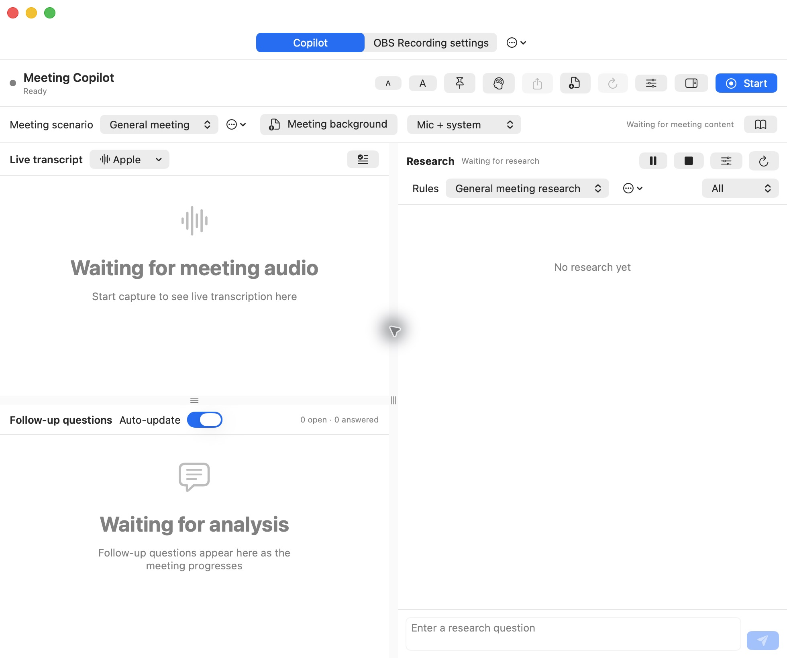
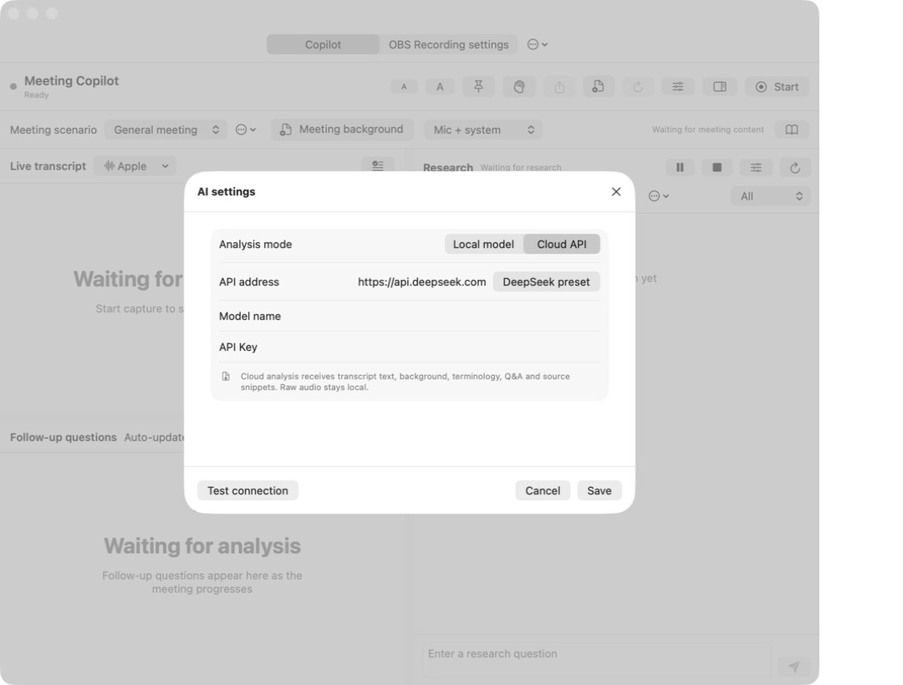

# Meeting Copilot

A macOS meeting assistant for live transcription, evidence-grounded follow-up questions, answer tracking and contextual research.

Use it for team planning, interviews, project reviews and decision discussions.



*Transcript, follow-up questions and research in one window. The optional OBS tab is enabled in this view.*

## Features

- Transcribe microphone audio, system audio or both using Apple's on-device speech recognition.
- Edit transcript segments while retaining the recognition original.
- Generate short follow-up questions tied to verbatim meeting evidence.
- Track answers, missing conditions, later supplements and corrections.
- Mark questions as asked without incorrectly marking them answered.
- Research a topic or ask a manual question with cited sources and explicit uncertainty.
- Import your own Markdown meeting and research scenarios.
- Save drafts locally and export transcript, Q&A and research as Markdown.
- Optionally use OBS for separate audio-file recording and Qwen for local transcription.

Audio channels identify capture sources; they do not identify every speaker. An answered question is not the same as an independently verified fact.

## Download and install

Requires an **Apple Silicon (M-series) Mac running macOS 26 or later**.

1. Download **Meeting-Copilot-1.0.0-macOS-arm64.dmg** from [Releases](https://github.com/xyh169/meeting-copilot/releases/latest).
2. Double-click the DMG and drag **Meeting Copilot.app** into **Applications**.
3. Open **Meeting Copilot** from Applications. The download includes Python and the backend dependencies; no Python or Xcode installation is needed.
4. In **AI settings**, enter your provider URL, model name and API key, or choose **Local model** and enter the name of an installed Ollama model.
5. Choose an audio source, press **Start** and grant the requested macOS permissions.

A ZIP containing the same App is also available. Extract it and drag the App into Applications. The **Source code** downloads are for developers.

The App is locally signed and is not Apple notarized. macOS may block the first launch. If you trust the download, use the normal approval flow in **System Settings → Privacy & Security**. See [Apple's guidance](https://support.apple.com/en-us/102445).

Apple transcription may need an initial speech-resource download. Cloud analysis and online research require network access. OBS, FFmpeg and Qwen are optional; install them only for the features you use. See [setup](docs/SETUP.md).

### Defaults

| Setting | Default |
| --- | --- |
| Transcription | Apple's on-device speech recognition |
| Audio sources | Microphone + system audio |
| Analysis | Cloud API setup; provider/model/key supplied in AI settings |
| Meeting scenario | General meeting |
| Research rules | General meeting research |
| Question auto-update | Enabled |
| Automatic research | Enabled after more than three minutes of substantive new discussion |
| Local excerpt sharing | Disabled |
| OBS module | Disabled |

Selections are saved for subsequent launches.

## A meeting workflow

1. Select **General meeting**, **Evidence review**, **Decisions and action items**, or an imported scenario.
2. Enter this meeting's background, goals and known terminology.
3. Choose microphone, system audio or both, then press **Start**.
4. Review transcript segments and edit recognition errors. Read follow-up questions and their quoted evidence.
5. Use **Mark as asked** after asking a suggested question. The app tracks direct, partial and nonresponsive answers conservatively.
6. Ask a manual research question or refresh contextual research. Review sources and uncertainty.
7. Pause/resume when needed. Press **Stop**, then **Export** to save the notes.
8. Use **New meeting** before switching topics or projects. It backs up the current meeting and clears its background and Q&A.

Question updates are incremental, normally batched at about 60 seconds. Automatic research requires more than three minutes of substantive new discussion on the same topic. Silence and pauses do not count. Manual research and refresh bypass that threshold.

Turning off question updates preserves existing Q&A and pauses answer updates and new questions. Transcription and research continue independently. Research pause/stop is separate from audio capture. Requests already sent to a provider may still be billed.

## Button guide

Hover over an icon to see its action. Audio capture, question updates, research and OBS recording have separate controls.

### Top toolbar

| Control | Action |
| --- | --- |
| More menu above the toolbar | Toggle **Enable OBS Module** to show or hide the OBS settings tab. Hiding the tab does not stop an OBS recording. |
| Smaller text / Larger text | Resize transcript and question text. |
| Pin icon | Keep the window on top, or return it to normal window behavior. |
| AI settings — head/brain icon | Configure the analysis provider, model and API key. |
| Export — upward arrow | Save the current transcript, questions, answers and research as a Markdown file. |
| New meeting — document with plus | Back up the current meeting and clear transcript, Q&A, research and background. Stop audio capture first. |
| Reanalyze — circular arrow | Keep the transcript, back up the existing Q&A and regenerate questions for this meeting. Requires question auto-update to be enabled. |
| OBS settings — sliders | Switch to the OBS recording settings tab; available when the OBS module is enabled. |
| Research sidebar icon | Show or hide the research panel. Hiding it does not pause research. |
| Start | Begin audio capture and transcription. If notes already exist, choose to continue them or start a new meeting with a backup. |
| Pause / Resume | Pause or resume capture while retaining this meeting's content. |
| Stop | End Copilot capture and keep its notes. OBS recording and research have their own stop buttons. |

Drag the dividers to adjust transcript/question height and research-panel width. Double-click a divider to reset it. Each panel scrolls independently.

### AI settings



| Control | Action |
| --- | --- |
| Local model / Cloud API | Select Ollama or an OpenAI-compatible analysis API. |
| Local model name | Enter the exact name of a model installed in Ollama. The app does not download it. |
| API address / Model name / API Key | Enter your provider's configuration. A saved key can be reused by leaving the key field blank. |
| DeepSeek preset | Fill the DeepSeek service address. Enter a model supported by your account. |
| Test connection | Send a small model request to check configuration; provider charges may apply. |
| Remove key | Remove the saved Meeting Copilot API key from macOS Keychain. |
| Save / Cancel / Close | Apply the settings, or dismiss the settings window. |

Transcription and analysis are separate: Apple/Qwen converts audio to text; Ollama/cloud APIs generate questions and research.

### Meeting scenario and background

| Control | Action |
| --- | --- |
| Meeting scenario menu | Choose **General meeting**, **Evidence review**, **Decisions and action items**, or an imported scenario. |
| More menu beside the scenario | Import Markdown, open the selected rule, open its folder or refresh the rule list. |
| Meeting background | Enter up to 6,000 characters of context, known facts and goals for this meeting. |
| Audio source menu | Select microphone, system audio or both. Stop capture before switching sources. |
| Book icon | Open the meeting guidance document. |

Background guides analysis; it is not recorded speech or a speech-recognition vocabulary. Use **New meeting** to clear it before changing projects.

### Transcript and follow-up questions

| Control or status | Action |
| --- | --- |
| Apple / Qwen menu | Select the local transcription engine. Stop capture before changing it. |
| Terminology — text/check icon | Add terminology hints and choose the questioner channel. |
| Questioner channel | Select microphone, system or manual marking. For several people sharing one microphone, use manual marking. |
| Pencil beside a transcript segment | Edit a completed segment. **Save** applies the correction; **Cancel** discards the edit. |
| Jump to latest — downward arrow | Return to the newest transcript and resume automatic following. Scrolling back or editing pauses following. |
| Draft status icon | Hover to inspect the local draft save status. |
| API input / output counts | View model token usage. Hover for request and cache details; billing is determined by your provider. |
| Auto-update beside Follow-up questions | Enable or pause answer updates, corrections and new questions. Existing Q&A remains; transcription, editing and research continue. The selection is remembered. |
| Mark as asked | Record that you have spoken the suggested question. This does not mark it answered. |
| Answered section | Review answers and later supplements. Nonresponsive answers and answers needing review are flagged. |
| Source links | Open the public sources used to check a claim. |

Questions are normally analyzed in batches about every 60 seconds. Turning off auto-update also disables reanalysis. Turning it back on resumes processing accumulated speech. Requests already submitted may still finish and be billed.

An **Answered** label means the conversation supplied information; it does not prove the information is independently verified. Check important numbers and names against the transcript and sources.

### Research panel

| Control | Action |
| --- | --- |
| Pause / Resume — pause/play icon | Pause or resume automatic research. Resuming starts a new discussion accumulation window. |
| Stop — square icon | Stop waiting for the current research and disable automatic updates, preserving results. Submitted requests may still be billed. |
| Research settings — sliders | Configure automatic research, online search and sharing of matching local document excerpts with a cloud model. |
| Refresh — circular arrow | Research the current discussion immediately, bypassing the automatic three-minute threshold. |
| Rules menu and its More menu | Select, import, open or refresh research rules. |
| All / Section menu | Filter research by category. |
| Question field and Send — paper-plane icon | Ask a specific question. The answer is saved as a separate research entry. |
| Sources / View sources | Open a webpage or locate a local file in Finder. |
| Search scope and evidence | Expand source excerpts, search notes and model usage for the report. |
| Update history | Inspect previous versions of a research item. |
| Done in Research settings | Close the settings window. |

Automatic research needs more than three minutes of substantive new discussion on the same topic. Silence, pauses and waiting do not count. The same topic and approach update an existing report; a different direction creates a new one. Manual answers remain separate. Reports are ordered by their most recent completed update.

### Optional OBS recording

Enable the OBS module from the top More menu after installing OBS. Configure its localhost WebSocket service and your recording sources in **OBS Recording settings**.

| Control | Action |
| --- | --- |
| Launch OBS audio engine | Configure WebSocket access and launch OBS. First-time configuration may require restarting OBS. |
| Open installer | Open an OBS installer already downloaded into the workspace. |
| Save settings | Save panel values. Use **Apply OBS Scene/filters** to write scene and filter changes to OBS. |
| Test connection | Check OBS WebSocket connectivity. |
| Apply OBS Scene/filters | Create or update audio sources, the recording scene and voice filters. |
| Sync recording mode | Apply microphone-only, meeting-audio-only or combined capture to OBS. |
| Start recording / Pause / Resume / Stop recording | Control the audio file recording in OBS. |
| Generate guide / Copy guide | Create a guide for the current recording configuration or copy it to the clipboard. |
| Clear log | Clear the panel's visible log. Recording files and meeting notes remain. |
| Reload — circular arrow | Reload the OBS settings page. |

Set the output directory, format and microphone, test the connection, apply settings and make a short test recording. Voice presets control suppression, gating, compression and limiting. If quiet speech is cut off, try **Natural voice** and review gate thresholds. **Hide OBS in background** controls the OBS window, not whether recording is active.

## Exports and troubleshooting

**What does Export save?** A Markdown document with meeting background, terminology, timed/source-labeled transcript, open questions, answers and research. Corrected transcript segments retain their recognition original. OBS saves audio separately.

**Why is there a transcript but no follow-up question?** Check AI settings, the provider connection, question auto-update and the analysis status. Transcription alone does not configure analysis.

**Why has research not refreshed?** Check whether it is paused and whether enough substantive new discussion has accumulated. Use Refresh or ask a manual question when you need an immediate answer.

**Can I export during a meeting?** Yes. The export contains results available at that moment. Export again after pending research finishes to include it.

**How do I add Qwen or local documents?** See [setup](docs/SETUP.md). Apple transcription is ready to use once its macOS permissions and speech resources are available.

## Scenarios and examples

Default meeting rules live in [`rules/interview`](rules/interview); research rules live in [`research-rules.md`](research-rules.md). Select a scenario from the meeting menu. Import a `.md` file to create your own local rule copy, or open a rule from the menu to edit it.

Browse the [team planning](examples/team-planning.md) and [investment discussion](examples/investment-discussion.md) examples to see how transcripts become notes and follow-up questions. Import the [investment review scenario](examples/investment-scenario.md) to tailor questions to that use case.

## Data and storage

Transcription runs locally. API keys are saved in macOS Keychain, and meeting drafts and exports are saved on your Mac.

When you choose a cloud analysis provider, it receives the text needed for analysis. Research can also search public sources and use documents you connect. Local document excerpts are shared with cloud research only when you enable that option.

See [data handling details](docs/PRIVACY.md) for storage locations and online feature settings.

## Build from source

Developers need Python 3.12 and Xcode or Command Line Tools with the macOS 26 SDK. From the project directory:

```sh
python3.12 -m venv .venv
.venv/bin/python -m pip install -r requirements.txt
zsh MeetingCopilotApp/build_app.sh
open "Meeting Copilot.app"
```

Run checks with:

```sh
.venv/bin/python -m unittest discover -s tests -v
zsh scripts/test_native.sh
```

The backend binds to `127.0.0.1:8766`. The browser page is the optional OBS recording settings panel; the native app provides transcription, questions and research. To open the recording panel separately:

```sh
.venv/bin/python obs_audio_web_gui.py
```

Source builds reference their project directory. Rebuild after moving it. Do not run multiple copies of this backend simultaneously.

Contributions are welcome. Read [CONTRIBUTING.md](CONTRIBUTING.md) before submitting changes.

To build the downloadable App and disk image, see [download runtime](docs/RUNTIME.md).
